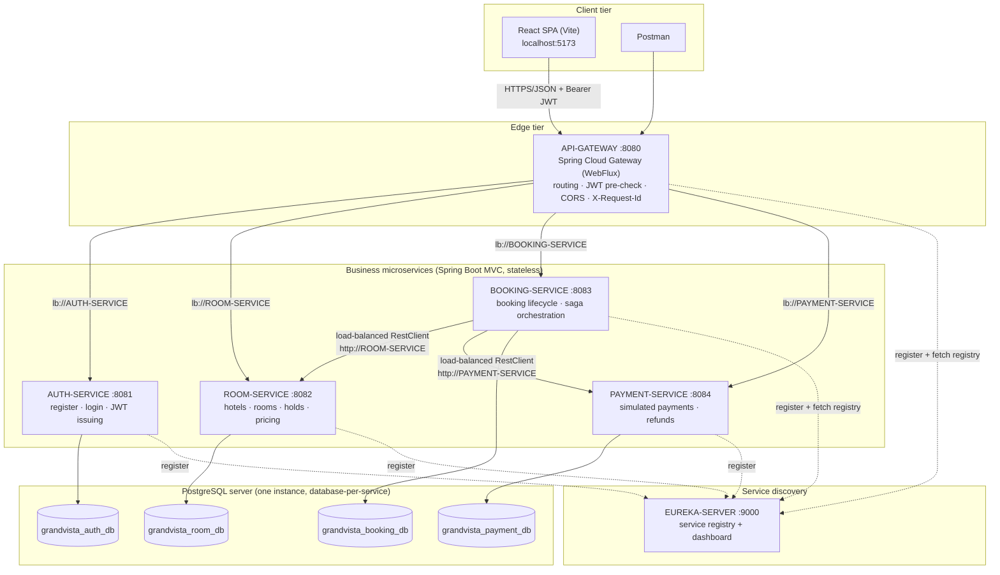
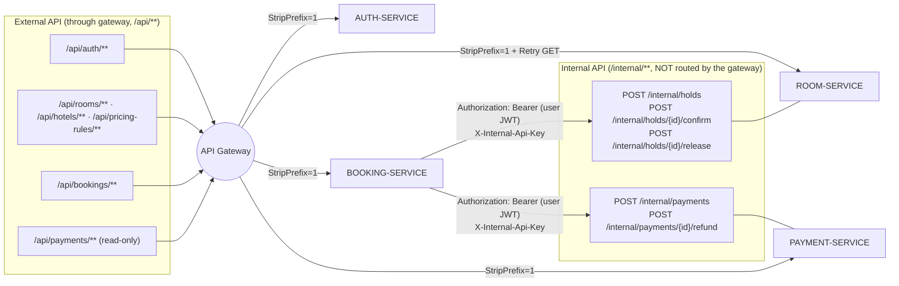
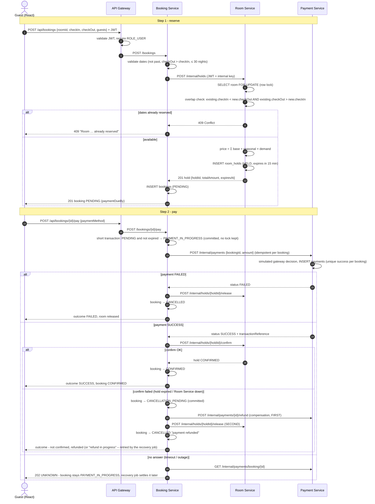
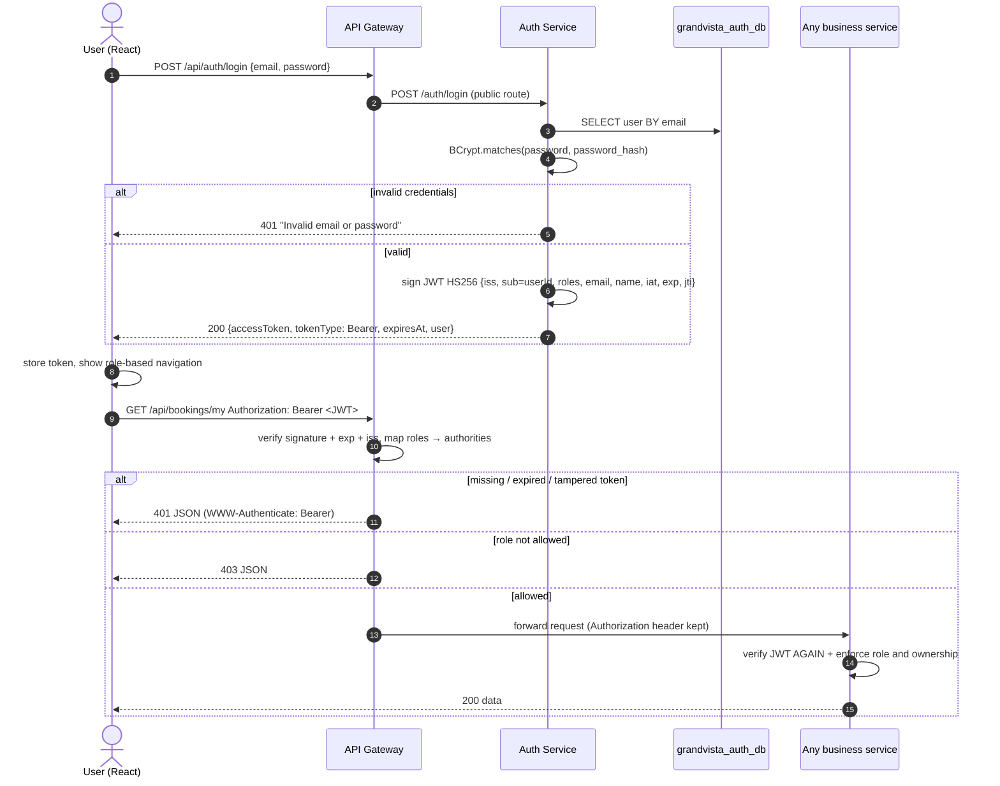
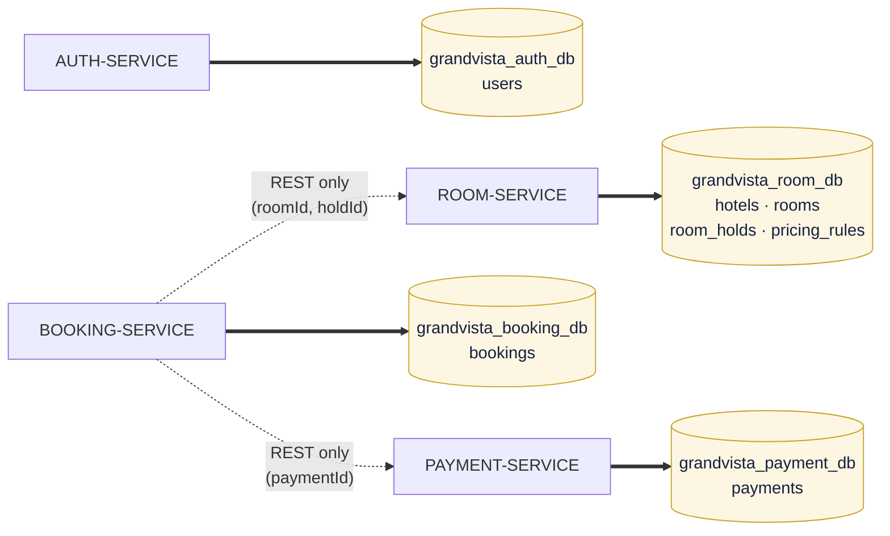
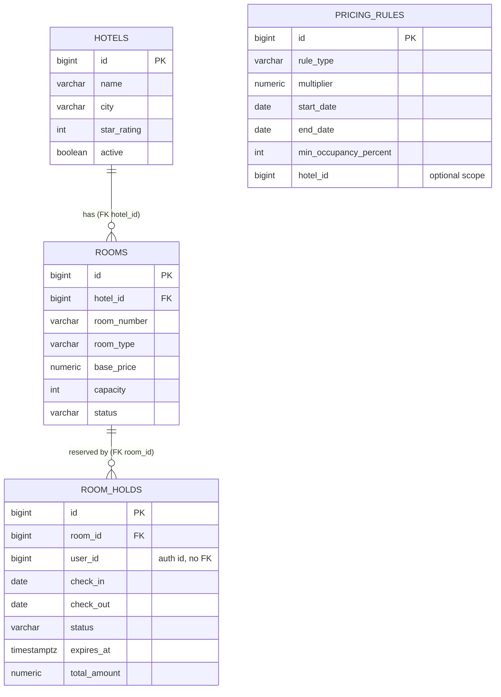

# GrandVista – Architecture Diagrams

All diagrams are Mermaid and render on GitHub, in VS Code (Markdown Preview Mermaid Support) or at
<https://mermaid.live>.

---

## A. System architecture

---

## B. Service communication

**Communication style:** synchronous REST/JSON. Service locations are never hard-coded: the gateway uses
`lb://SERVICE-NAME` URIs and Booking Service uses a load-balanced `RestClient` with `http://SERVICE-NAME`
base URLs. Spring Cloud LoadBalancer resolves these names against the Eureka registry (round-robin).

---

## C. Booking sequence (Booking → Payment → Room update)

---

## D. Authentication flow (JWT)

---

## E. Database ownership

Solid arrows: the only database connection each service has. Dotted arrows: cross-service references are **plain
ID columns** resolved through REST calls; there are no cross-database foreign keys.

---

## F. Entity relationships per database

