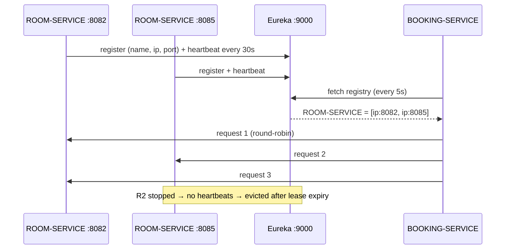

# 05 – Service Discovery and Load Balancing

## 1. Why service discovery

In a microservice system, instances start, stop and move between ports/hosts. Hard-coding
`http://localhost:8082` in the gateway or in Booking Service would break as soon as Room Service is scaled or
moved. **Client-side service discovery** solves this:

1. Every service **registers** itself in a registry with its logical name, host, port and health.
2. Callers **fetch** the registry and resolve a logical name to a live instance at call time.
3. A **load balancer** in the caller picks one instance when several are registered.

## 2. Components used

| Component | Version | Role |
|---|---|---|
| `spring-cloud-starter-netflix-eureka-server` | 5.0.2 (Spring Cloud 2025.1.3) | Registry + dashboard in `eureka-server` |
| `spring-cloud-starter-netflix-eureka-client` | 5.0.2 | Registration/fetching in all other services |
| `spring-cloud-starter-loadbalancer` | 5.0.3 | Round-robin instance selection (the current replacement for Netflix Ribbon, which is **not** used) |

## 3. Eureka Server configuration (`eureka-server/src/main/resources/application.properties`)

Dashboard: **<http://localhost:9000>**

```properties
spring.application.name=eureka-server
server.port=${EUREKA_PORT:9000}
eureka.instance.hostname=localhost
# the registry does not register with itself and does not fetch from a peer (standalone)
eureka.client.register-with-eureka=false
eureka.client.fetch-registry=false
eureka.client.service-url.defaultZone=http://${eureka.instance.hostname}:${server.port}/eureka/
# evict stopped instances quickly during demos
eureka.server.enable-self-preservation=false
eureka.server.eviction-interval-timer-in-ms=10000
```

Self-preservation is disabled only because, in a classroom demo, services are stopped and restarted often;
production registries keep it enabled.

## 4. Client configuration (every service)

```properties
# registered as ROOM-SERVICE
spring.application.name=room-service
eureka.client.service-url.defaultZone=${EUREKA_URL:http://localhost:9000/eureka/}
eureka.instance.prefer-ip-address=true
# unique per port -> multiple instances visible
eureka.instance.instance-id=${spring.application.name}:${server.port}
```

Registered names:

| `spring.application.name` | Shown in Eureka as | Port |
|---|---|---|
| api-gateway | API-GATEWAY | 8080 |
| auth-service | AUTH-SERVICE | 8081 |
| room-service | ROOM-SERVICE | 8082 (+ extra instances) |
| booking-service | BOOKING-SERVICE | 8083 |
| payment-service | PAYMENT-SERVICE | 8084 |

## 5. Where discovery is used

### 5.1 API Gateway → services

```properties
spring.cloud.gateway.server.webflux.routes[1].id=room-service
# "lb" = resolve through Spring Cloud LoadBalancer + Eureka
spring.cloud.gateway.server.webflux.routes[1].uri=lb://ROOM-SERVICE
spring.cloud.gateway.server.webflux.routes[1].predicates[0]=Path=/api/rooms/**,/api/hotels/**,/api/pricing-rules/**
```

`discovery.locator.enabled` is **false**: routes are explicit, so no service or internal endpoint is published by
accident.

### 5.2 Booking Service → Room / Payment Service

```java
@Bean
RestClient roomServiceRestClient(DeferringLoadBalancerInterceptor loadBalancerInterceptor, ClientProperties p) {
    return RestClient.builder()
            .baseUrl(p.roomServiceUrl())                 // http://ROOM-SERVICE
            .requestFactory(requestFactoryWithTimeouts)
            .requestInterceptor(loadBalancerInterceptor) // Spring Cloud LoadBalancer + Eureka
            .build();
}
```

A call such as `POST http://ROOM-SERVICE/internal/holds` is intercepted; `ROOM-SERVICE` is replaced by
`192.168.x.x:8082` (or `:8085`, …) of a registered instance. `DeferringLoadBalancerInterceptor` is the same
interceptor that `@LoadBalanced` would add.

> **Lesson learned during integration:** the first version declared a shared `@LoadBalanced RestClient.Builder`
> bean. That replaced Spring Boot's default builder, which the **Eureka client itself** uses to call
> `http://localhost:9000`. The load balancer then treated `localhost` as a service name, and Booking Service never
> registered. The interceptor is now attached only to the two service clients.

`RestClient` (Spring Framework 7) was chosen over OpenFeign: it is the currently recommended synchronous client,
needs no extra annotation-processing library, and makes headers, timeouts and error translation explicit and easy
to explain.

## 6. Registration and lookup sequence



## 7. Load balancing demonstration (two Room Service instances)

1. Start Eureka, Auth, Room (8082), Booking, Payment, Gateway normally.
2. Start a **second Room Service** on port 8085 (same database – services are stateless):
   * **Command line:** `cd room-service` → `mvn spring-boot:run -Dspring-boot.run.arguments=--server.port=8085`
   * **STS:** *Run → Run Configurations… → Spring Boot App → room-service* → duplicate → *Override properties*:
     `server.port = 8085` → Run. (Or *Arguments → Program arguments*: `--server.port=8085`.)
   * The demo seeder does nothing in the second instance because data already exists.
3. Open <http://localhost:9000>: **ROOM-SERVICE** shows **2** instances (`room-service:8082`, `room-service:8085`).
4. Call `GET http://localhost:8080/api/rooms` several times (Postman *Runner* or browser refresh).
   Each response carries the header **`X-Instance-Id`** (`room-service:8082` / `room-service:8085`, added by
   `InstanceIdFilter`), and each Room Service console logs `room-service:<port> served GET /rooms` – the values
   alternate, demonstrating round-robin distribution.
5. Create bookings: Booking Service's hold calls also alternate between both Room instances.
6. Stop the 8085 instance. For a short time the registry may still list it; the gateway's `Retry` filter retries
   GETs on connection errors, and after eviction all traffic goes to 8082.

Correctness with two instances is preserved because the collision lock is a **database row lock**
(`SELECT … FOR UPDATE`), not a JVM lock – it works across instances sharing `grandvista_room_db`.

## 8. Failure behaviour

| Situation | Result |
|---|---|
| Room Service not registered / all instances down | Booking Service → `503 "ROOM-SERVICE is currently unavailable…"`; Gateway → 503 |
| Eureka down after services already fetched registry | Calls keep working with the cached registry |
| One of two instances killed | Traffic moves to the remaining instance after eviction; gateway retries idempotent GETs |
