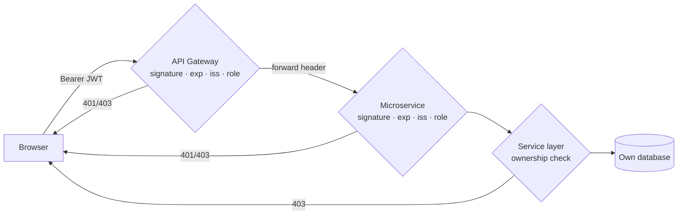

# 06 – JWT Authentication and Authorization

## 1. Design summary

| Aspect | Decision |
|---|---|
| Identity provider | **AUTH-SERVICE** – the only service that knows passwords and signs tokens |
| Token format | JWT (JWS compact), **HS256** (HMAC-SHA256) |
| Library | Spring Security 7 `oauth2-jose` (Nimbus JOSE+JWT) – `NimbusJwtEncoder` / `NimbusJwtDecoder` |
| Key | Base64 secret ≥ 32 bytes from `JWT_SECRET` (env var or git-ignored local file); service refuses to start if missing or too short |
| Lifetime | 60 minutes (`JWT_EXPIRATION_MINUTES`) |
| Transport | `Authorization: Bearer <token>` header |
| Session | **Stateless** (`SessionCreationPolicy.STATELESS`), CSRF disabled because no cookies are used |
| Password storage | **BCrypt** (`BCryptPasswordEncoder`, strength 10, random salt per password) |
| Validation points | API Gateway (reactive resource server) **and** every business service (servlet resource server) |

`jjwt` was deliberately not used: its Jackson module depends on Jackson 2, while Spring Boot 4 uses Jackson 3.
Spring Security's own JOSE support is the officially recommended option and avoids the conflict.

## 2. Token contents

```json
// header
{ "alg": "HS256" }
// payload
{
  "iss":   "grandvista-auth-service",
  "sub":   "7",                          // user id → owner of bookings/payments
  "email": "asha@example.com",
  "name":  "Asha Reddy",
  "roles": ["ROLE_USER"],
  "iat":   1789370000,
  "exp":   1789373600,
  "jti":   "1c7e7c5e-…"                   // unique token id
}
```

No password, hash or other secret is placed in the token (JWT payloads are only Base64-encoded, not encrypted).

## 3. Registration and administrator creation

* `POST /auth/register` accepts **only** `name`, `email`, `password` (`RegisterRequest` record has no role field).
  Extra JSON such as `"role":"ROLE_ADMIN"` is ignored – verified by
  `AuthControllerSecurityTest#registrationIgnoresInjectedRoleField`. The role is hard-set to `ROLE_USER` in
  `AuthServiceImpl`.
* Validation: valid email, 8–72 character password containing a letter and a digit (72 = BCrypt input limit).
* Emails are trimmed and lower-cased; a unique DB constraint also protects against concurrent duplicates.
* **First administrator:** `AdminInitializer` (an `ApplicationRunner`) creates one `ROLE_ADMIN` on startup **only
  if** no admin exists **and** `ADMIN_PASSWORD` is configured. Email defaults to `admin@grandvista.com`
  (`ADMIN_EMAIL`). The password comes from configuration only and is never logged.
* **Further administrators:** an existing admin promotes a user with `PATCH /auth/users/{id}/role`; admins cannot
  change their own role (prevents lock-out).

## 4. Login

```
POST /api/auth/login  {"email":"asha@example.com","password":"Secret123"}
→ 200 {"accessToken":"eyJ…","tokenType":"Bearer","expiresAt":"2026-09-14T11:00:00Z","user":{…}}
```

`AuthenticationManager` → `DaoAuthenticationProvider` → `UserDetailsService` (by email) → `BCrypt.matches`.
Unknown email and wrong password both return **401 "Invalid email or password"** (no account enumeration);
Spring's provider also performs a dummy hash for unknown users to reduce timing differences.

## 5. Token validation (every resource server)

```java
NimbusJwtDecoder decoder = NimbusJwtDecoder.withSecretKey(key).macAlgorithm(MacAlgorithm.HS256).build();
decoder.setJwtValidator(new DelegatingOAuth2TokenValidator<>(
        JwtValidators.createDefaultWithIssuer("grandvista-auth-service")));   // exp, nbf, iss
```

The `roles` claim is mapped directly to authorities (`JwtGrantedAuthoritiesConverter`, prefix `""`), so
`hasRole('ADMIN')` checks `ROLE_ADMIN`.

## 6. Error handling

| Case | HTTP | JSON `message` | Where produced |
|---|---|---|---|
| No `Authorization` header on protected endpoint | 401 + `WWW-Authenticate: Bearer` | `Authentication required: provide a valid 'Authorization: Bearer <token>' header` | Gateway / service entry point |
| Malformed token, bad signature, wrong issuer | 401 | `JWT token is invalid or malformed` | same |
| Expired token | 401 | `JWT token has expired` | same |
| Valid token, insufficient role | 403 | `You do not have permission to access this resource` | access-denied handler |
| Valid token, not the owner of the booking/payment | 403 | `You do not have permission to perform this action` | service layer → `@RestControllerAdvice` |
| Wrong login credentials | 401 | `Invalid email or password` | Auth Service |

Example body:

```json
{"timestamp":"2026-09-14T05:12:44Z","status":401,"error":"Unauthorized",
 "message":"JWT token has expired","path":"/api/bookings/my"}
```

## 7. Public vs secured endpoints

| Endpoint (through gateway) | Access |
|---|---|
| `POST /api/auth/register`, `POST /api/auth/login` | Public |
| `GET /api/hotels/**`, `GET /api/rooms`, `GET /api/rooms/{id}`, `/availability`, `/price` | Public |
| `GET /api/auth/me` | Authenticated |
| `POST /api/bookings`, `POST /api/bookings/{id}/pay`, `GET /api/bookings/my` | `ROLE_USER` |
| `GET /api/bookings/{id}`, `POST /api/bookings/{id}/cancel` | Authenticated + owner or admin |
| `GET /api/payments/my`, `GET /api/payments/{id}`, `GET /api/payments/booking/{id}` | Authenticated + owner or admin |
| `POST/PUT/PATCH/DELETE /api/rooms/**`, `/api/hotels/**` | `ROLE_ADMIN` |
| `GET /api/rooms/all`, `/api/rooms/inventory-summary`, `/api/rooms/{id}/holds` | `ROLE_ADMIN` |
| `/api/pricing-rules/**`, `/api/auth/users/**`, `GET /api/bookings`, `GET /api/payments` | `ROLE_ADMIN` |
| `/internal/**` (any service) | Not reachable via gateway; direct calls need JWT **and** `X-Internal-Api-Key` |

## 8. Defence in depth



Even if someone bypasses the gateway and calls `localhost:8083` directly, the service validates the token and
roles itself. Service-to-service calls propagate the **user's** JWT, so Room and Payment Service still know who
the user is and enforce ownership (e.g. a user cannot release another user's hold).

## 9. Frontend handling

* Token and user profile stored in `localStorage` (`tokenStorage.js`); attached by the single API client.
* `AuthContext` logs out automatically when `exp` is reached and whenever an authenticated call returns 401,
  redirecting to the login page with a message.
* Route guards (`ProtectedRoute`) only improve UX – the backend is the authority.

## 10. Tests proving the behaviour

| Test | Proves |
|---|---|
| `JwtTokenProviderTest` | claims/expiry correct; expired, tampered (role changed) and foreign-key tokens rejected; weak secret refused |
| `AuthServiceImplTest` | BCrypt hash stored (not plain), role forced to USER, duplicate email, bad credentials |
| `AuthControllerSecurityTest` | validation 400, 401 JSON without token, 403 for USER on admin endpoint, injected role ignored |
| `SecurityErrorWriterTest` | missing vs expired vs malformed messages |
| `GatewaySecurityIntegrationTest` | real gateway: 401 missing/malformed/expired, 403 wrong role, internal paths blocked, CORS |
| `RoomSecurityTest`, `BookingSecurityTest`, `PaymentSecurityTest` | per-service enforcement independent of gateway |

## 11. Limitations (stated honestly)

HS256 means every validating service holds the signing secret; production would use RS256 with a JWKS endpoint so
only the auth server can sign. There are no refresh tokens or revocation list – a stolen token is valid until it
expires (60 min). `localStorage` is exposed to XSS; production would prefer httpOnly cookies. See
`03-non-functional-requirements.md`.
