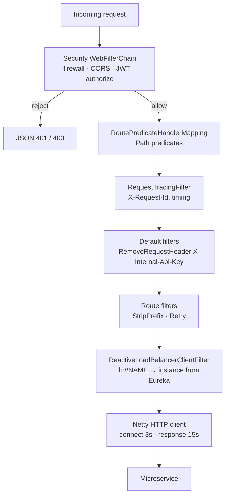

# 07 – API Gateway

## 1. Role of the gateway

`api-gateway` (Spring Cloud Gateway **Server WebFlux** 5.0.3, Netty, port **8080**) is the single entry point for
the React client and Postman. It provides:

| Concern | Implementation |
|---|---|
| Centralised routing | Explicit routes in `application.properties`, `lb://` URIs resolved via Eureka |
| Path normalisation | External `/api/**` prefix removed with `StripPrefix=1` |
| Edge security | Reactive OAuth2 resource server: JWT signature/expiry/issuer + role rules; JSON 401/403 |
| Hiding internals | `discovery.locator.enabled=false`, `anyExchange().denyAll()` – `/internal/**`, `/eureka/**`, other actuator endpoints unreachable |
| Header hygiene | `RemoveRequestHeader=X-Internal-Api-Key` default filter (clients cannot impersonate services) |
| CORS | One `CorsConfigurationSource` bean for `/api/**` |
| Resilience | `httpclient.connect-timeout=3000` ms, `httpclient.response-timeout=15s`; `Retry` (2×, GET only) on Room routes |
| Traceability | `RequestTracingFilter`: `X-Request-Id` added/propagated/returned + one log line per request |
| Security headers | Spring Security WebFlux defaults (X-Content-Type-Options, X-Frame-Options, Cache-Control, …); strict server web-exchange firewall rejects encoded `/`, `..` path tricks |

## 2. Routing table

| Route id | External path (client) | Forwarded path | Target (Eureka) | Filters | Public examples |
|---|---|---|---|---|---|
| `auth-service` | `/api/auth/**` | `/auth/**` | `lb://AUTH-SERVICE` | StripPrefix=1 | `POST /api/auth/login` |
| `room-service` | `/api/rooms/**` | `/rooms/**` | `lb://ROOM-SERVICE` | StripPrefix=1, Retry(GET) | `GET /api/rooms?city=Chennai` |
| `room-service` | `/api/hotels/**` | `/hotels/**` | `lb://ROOM-SERVICE` | same | `GET /api/hotels` |
| `room-service` | `/api/pricing-rules/**` | `/pricing-rules/**` | `lb://ROOM-SERVICE` | same | admin only |
| `booking-service` | `/api/bookings/**` | `/bookings/**` | `lb://BOOKING-SERVICE` | StripPrefix=1 | `POST /api/bookings` |
| `payment-service` | `/api/payments/**` | `/payments/**` | `lb://PAYMENT-SERVICE` | StripPrefix=1 | `GET /api/payments/my` |
| *(none)* | `/internal/**`, `/eureka/**`, anything else | – | – | **denied (403)** | – |

Default filter on every route: `RemoveRequestHeader=X-Internal-Api-Key`.

## 3. Authorization rules at the edge (`GatewaySecurityConfig`)

Order matters – first match wins:

```java
.pathMatchers(HttpMethod.OPTIONS, "/**").permitAll()                               // CORS preflight
.pathMatchers("/actuator/health", "/actuator/info").permitAll()
.pathMatchers(HttpMethod.POST, "/api/auth/register", "/api/auth/login").permitAll()
.pathMatchers("/api/auth/users/**").hasRole("ADMIN")
.pathMatchers("/api/auth/**").authenticated()
.pathMatchers(HttpMethod.GET, "/api/rooms/all", "/api/rooms/inventory-summary", "/api/rooms/*/holds").hasRole("ADMIN")
.pathMatchers("/api/pricing-rules/**").hasRole("ADMIN")
.pathMatchers(HttpMethod.GET, "/api/rooms", "/api/rooms/**", "/api/hotels", "/api/hotels/**").permitAll()
.pathMatchers("/api/rooms/**", "/api/hotels/**").hasRole("ADMIN")
.pathMatchers(HttpMethod.GET, "/api/bookings").hasRole("ADMIN")
.pathMatchers(HttpMethod.POST, "/api/bookings", "/api/bookings/*/pay").hasRole("USER")
.pathMatchers("/api/bookings/**").authenticated()
.pathMatchers(HttpMethod.GET, "/api/payments").hasRole("ADMIN")
.pathMatchers(HttpMethod.GET, "/api/payments/**").authenticated()
.anyExchange().denyAll()
```

**Why validate at the gateway if services validate too?** Invalid or unauthorised requests are rejected early,
without consuming a network hop, a service thread or a database connection – important during peak traffic. The
services still enforce the same rules plus ownership (defence in depth), so the gateway is an optimisation and a
first barrier, not the only one.

## 4. CORS

```java
cors.setAllowedOrigins(properties.cors().originList());   // CORS_ALLOWED_ORIGINS, default http://localhost:5173
cors.setAllowedMethods(List.of("GET", "POST", "PUT", "PATCH", "DELETE", "OPTIONS"));
cors.setAllowedHeaders(List.of("Authorization", "Content-Type", "X-Request-Id"));
cors.setExposedHeaders(List.of("X-Request-Id"));
cors.setAllowCredentials(false);        // bearer header, no cookies
cors.setMaxAge(Duration.ofHours(1));    // browsers cache preflight results
```

* No wildcard origin: only the Vite dev server. Add more origins comma-separated in `CORS_ALLOWED_ORIGINS`.
* CORS is configured **only** at the gateway; microservices do not add CORS headers, so no duplicate
  `Access-Control-Allow-Origin` headers occur.
* Tested: preflight from `http://localhost:5173` → 200 with allow-origin; from `http://evil.example.com` → 403.

## 5. Request flow inside the gateway



## 6. Log output example

```
[4f1c…] POST /api/bookings -> route=booking-service status=201 CREATED 184ms
[9a2e…] GET /api/pricing-rules -> route=none status=403 FORBIDDEN 3ms
```

The Authorization header, tokens and bodies are never logged.

## 7. Verification

`GatewaySecurityIntegrationTest` starts the real gateway (Eureka disabled) and checks public route pass-through,
401 for missing/malformed/expired tokens, 403 for user tokens on admin routes, blocking of `/internal/**` and
`/eureka/**`, and the CORS policy. Manual checks are listed in `10-review-demonstration-guide.md`.

## 8. Not implemented (future work)

Rate limiting (`RequestRateLimiter` needs Redis – excluded by project constraints), circuit breakers, TLS
termination, response caching.
