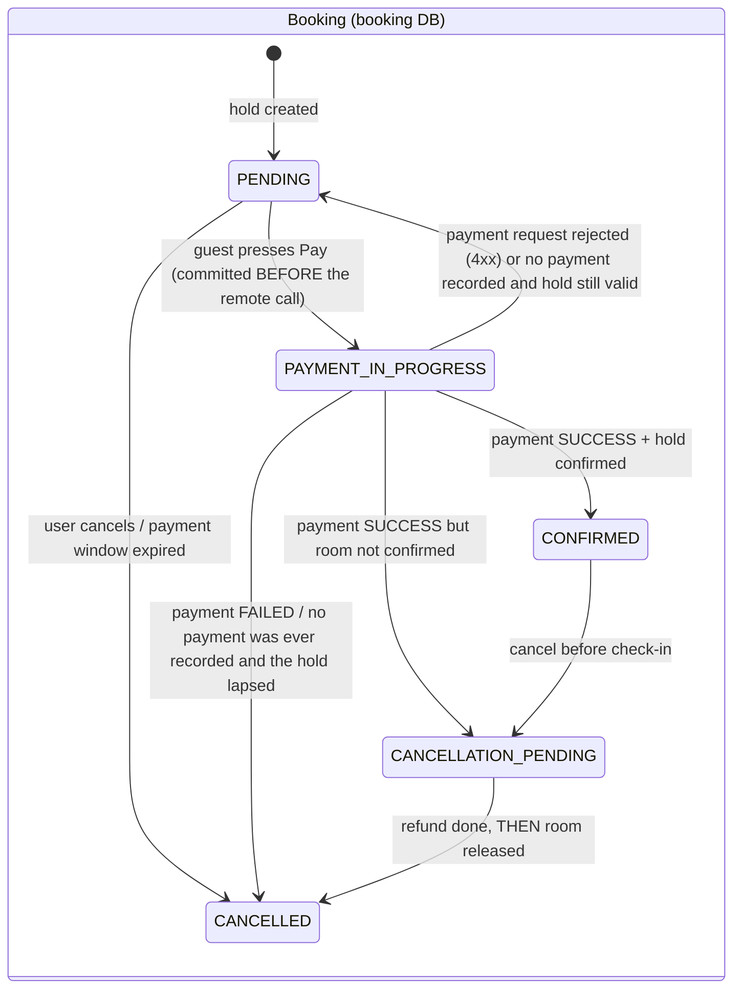
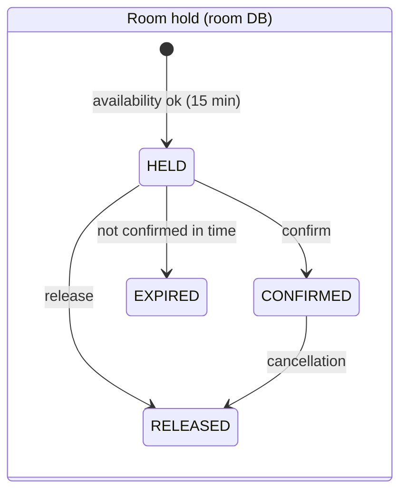

# 09 – Booking Workflow, Collision Prevention and Consistency

## 1. States



`PAYMENT_IN_PROGRESS` and `CANCELLATION_PENDING` are **persisted recovery states**: if a call times out or a service
crashes in the middle of the workflow the booking is parked in one of them and a recovery job finishes the work
(section 6). They are never expired or cancelled blindly.



| Payment status | Meaning |
|---|---|
| SUCCESS | simulated gateway approved |
| FAILED | declined (demo switch or amount above limit) |
| REFUNDED | successful payment reversed (cancellation or compensation) |

## 2. Step 1 – create booking (`POST /api/bookings`)

1. Gateway checks JWT and `ROLE_USER`.
2. Booking Service validates the body (`@NotNull`, `@FutureOrPresent`, guests 1–10) and the range
   (check-out after check-in, ≤ 30 nights) – invalid requests never reach Room Service.
3. Booking Service → `POST http://ROOM-SERVICE/internal/holds` (user JWT + internal key).
4. Room Service, **in one database transaction**:
   1. `SELECT * FROM rooms WHERE id = ? FOR UPDATE` – lock the room row;
   2. room must be ACTIVE in an active hotel; guests ≤ capacity;
   3. overlap count on `room_holds` must be 0;
   4. calculate price (rules + occupancy);
   5. `INSERT room_holds (status HELD, expires_at = now + 15 min)`;
   6. commit → lock released.
5. Booking Service stores a PENDING booking using the hold's ids, snapshot and **server-calculated amount**.
6. If saving the booking fails, the hold is released immediately (compensation).

## 3. Collision prevention in detail

### 3.1 Overlap rule

Two stays overlap when **each starts before the other ends**:

```
requested.checkIn < existing.checkOut   AND   requested.checkOut > existing.checkIn
```

Check-out is exclusive (the guest leaves in the morning), so back-to-back stays are allowed.

| Existing (room 203) | Requested | Overlap? | Why |
|---|---|---|---|
| 20 → 23 Sep | 22 → 25 Sep | **Yes – rejected** | 22 < 23 and 25 > 20 (specification example) |
| 20 → 23 Sep | 18 → 21 Sep | Yes | 18 < 23 and 21 > 20 |
| 20 → 23 Sep | 21 → 22 Sep | Yes | inside |
| 20 → 23 Sep | 23 → 25 Sep | **No – allowed** | 23 < 23 is false |
| 20 → 23 Sep | 17 → 20 Sep | No | 20 > 20 is false |

Implemented identically in `StayPeriod#overlaps` (unit-tested with all rows above) and in the JPQL of
`RoomHoldRepository#countBlockingHolds` (tested against a real H2 database).

### 3.2 Why a lock is needed

Without a lock, two requests could both run the overlap `SELECT`, both see 0 rows, and both `INSERT` – a classic
*check-then-act* race. PostgreSQL's default READ COMMITTED isolation does not prevent this by itself.

### 3.3 Chosen strategy: pessimistic row lock per room

```
T1: SELECT … FROM rooms WHERE id=3 FOR UPDATE   → lock acquired
T2: SELECT … FROM rooms WHERE id=3 FOR UPDATE   → waits
T1: count overlaps = 0 → INSERT hold → COMMIT   → lock released
T2: lock acquired → count overlaps = 1 → 409 Conflict → ROLLBACK
```

* Serialises only requests for the **same room**; other rooms proceed in parallel.
* Works across **multiple Room Service instances**, because the lock lives in the shared database.
* Simple to explain and to verify.

**Proof:** `ConcurrentHoldIntegrationTest` releases 8 threads at the same instant, all requesting the same room and
dates. Result: exactly **1 success, 7 rejections, 1 row**. As a control experiment the `@Lock` annotation was
temporarily removed: the same test then produced **8 successful holds** (double-booking), confirming that the lock –
not luck – prevents collisions.

**Alternatives considered:** optimistic locking on a room version (causes retries under contention), SERIALIZABLE
isolation (whole-transaction retries), a PostgreSQL `EXCLUDE USING gist` constraint on `daterange` (strongest, but
cannot express the time-based expiry of HELD rows and needs the `btree_gist` extension). The row lock gives
correct behaviour with the least complexity for this project.

## 4. Step 2 – pay (`POST /api/bookings/{id}/pay`)

Booking Service. **No database transaction or lock is held while a remote service is called**; every local state
change is a short transaction that re-checks the status under a row lock.

| # | Action | On failure |
|---|---|---|
| 1 | *Claim* (short transaction): booking exists, belongs to caller, status PENDING, hold not expired → status becomes **PAYMENT_IN_PROGRESS** and is committed | 404 / 403 / 409; an expired window cancels the booking and releases the hold without charging |
| 2 | `POST PAYMENT-SERVICE/internal/payments` (amount from the booking, **idempotent per booking**) | see below |
| 3a | Payment **FAILED** | booking CANCELLED "Payment failed: …", hold released |
| 3b | Payment **SUCCESS** → payment id stored, then `POST ROOM-SERVICE/internal/holds/{id}/confirm` | confirm fails → booking **CANCELLATION_PENDING** → refund, *then* release (section 5) |
| 4 | Booking CONFIRMED with payment id + transaction reference | – |

What happens when step 2 does not return a clean answer:

| Situation | Behaviour |
|---|---|
| Payment Service rejects the request (4xx) | nothing was charged: booking returns to PENDING, the guest may retry; the 4xx is passed on |
| Timeout, connection lost, 5xx, no instance registered | the charge may or may not have happened. The booking **stays PAYMENT_IN_PROGRESS**; Booking Service asks `GET /internal/payments/booking/{id}` once, and if that is also unavailable it answers **202** with `paymentStatus: "UNKNOWN"` ("do not pay again"). The recovery job resolves it later. |
| A second "Pay" click or a cancel while PAYMENT_IN_PROGRESS | 409 – only the payment outcome may move the booking on |

Payment Service makes the charge idempotent twice over: an application check returns the original SUCCESS payment for
a repeated request, and the database column `payments.success_booking_id` has a **unique constraint**, so two racing
requests cannot both insert a successful charge (the loser catches the violation and returns the winner).

## 5. Cancellation and expiry

* **PENDING** → CANCELLED, hold released (a hold that could not be released still lapses on its own).
* **CONFIRMED** (only before check-in date) → **CANCELLATION_PENDING** (committed) → **refund first**, then
  release the room → CANCELLED. Releasing the room only after the money is returned means the inventory is never
  freed for a new guest while the original booking is still paid and confirmed. Both remote operations are
  idempotent; if either fails the booking simply stays CANCELLATION_PENDING (the room stays reserved) and the
  recovery job retries. Calling cancel again just retries the unfinished cancellation.
* **Expiry:** a HELD row stops blocking the room the moment `expires_at` passes (the condition is part of every
  availability query), so inventory is never blocked incorrectly even if Booking Service crashes. Housekeeping
  jobs run every minute: Room Service marks such holds EXPIRED; Booking Service marks the matching **PENDING**
  bookings CANCELLED (a booking in PAYMENT_IN_PROGRESS is never expired by this job).

## 6. Distributed consistency – what is and is not guaranteed

There is **no ACID transaction spanning the three databases** and none is claimed. The workflow is an
**orchestration-based saga with persisted recovery states**: each step commits locally, each failure path has an
explicit compensating action, and the intermediate states survive a crash.

| Guarantee | Provided by |
|---|---|
| No two active holds overlap for a room | local transaction + row lock in Room Service (proven on real PostgreSQL, 16 concurrent requests → 1 winner) |
| Unpaid bookings never block inventory permanently | hold expiry built into the availability query |
| Failed payment frees the room | release compensation (and expiry as fallback) |
| Paid but unconfirmable booking is refunded | CANCELLATION_PENDING → refund, retried until it succeeds |
| **A booking can never be charged twice** | idempotent payment per booking + `uk_payments_success_booking` unique constraint |
| **An ambiguous payment is never cancelled blindly** | stays PAYMENT_IN_PROGRESS; the Payment Service is asked what really happened |
| **Inventory is not released while the guest is still paid** | cancellation refunds first, releases second |
| No database lock is held across a remote call | state changes are short transactions around the calls |
| Two instances (or request thread + recovery job) cannot complete the same step twice | every transition re-checks the status under a row lock; all remote operations are idempotent |

**Recovery job** (`BookingRecoveryScheduler`, every 30 s on every Booking Service instance):

| Booking found in … for longer than | Action |
|---|---|
| PAYMENT_IN_PROGRESS (`grandvista.booking.payment-recovery-after`, 60 s – must stay above the 10 s client read timeout) | ask Payment Service: SUCCESS → store payment, confirm room (or refund if the hold meanwhile expired); FAILED → cancel + release; **no attempt recorded** → back to PENDING if the hold is still valid, otherwise CANCELLED + release; Payment Service unreachable → leave untouched, retry next round |
| CANCELLATION_PENDING (`grandvista.booking.cancellation-retry-after`, 30 s) | refund (idempotent) → release room (404 = already gone) → CANCELLED |

**Internal authentication of the recovery job:** it runs outside any user request, so it calls the internal endpoints
with the internal API key only. Room and Payment Service treat "valid key, no Authorization header" as the trusted
*system* principal (administrator-equivalent, no user id): it may confirm/release holds, refund and look up payments,
but it can **not** create a hold or a payment (those need a guest). A request that carries an invalid JWT is still
rejected with 401 even when it also carries the key.

**Known residual windows (documented, not hidden):**

1. If the Payment Service accepts a payment request but its processing finishes **more than
   `payment-recovery-after` (60 s) after the request was sent**, and the recovery job meanwhile found no attempt and
   cancelled the booking, a successful charge could exist for a cancelled booking. With a 10 s read timeout this
   requires a payment that takes six times longer than the client is willing to wait. A production system would add a
   reconciliation sweep of SUCCESS payments against bookings (or the transactional outbox pattern).
2. A refund that can never succeed (for example the payment record was deleted) leaves the booking in
   CANCELLATION_PENDING and is retried and logged every 30 s; it needs manual intervention.
3. The Booking Service request thread still performs the remote calls synchronously (the guest waits for the
   result); only the *locks* were removed, not the latency. Real payment providers would use asynchronous callbacks.
4. The simulated payment gateway is deterministic and never contacts a bank.

## 7. Tests covering the workflow

| Test class | Scenarios |
|---|---|
| `StayPeriodTest` | overlap table above, reversed/past/too-long ranges |
| `RoomHoldRepositoryTest` | confirmed/held block, expired/released do not, date search excludes reserved rooms |
| `ConcurrentHoldIntegrationTest` | 8 concurrent requests → 1 success (H2) |
| `ConcurrentHoldPostgresIntegrationTest` | on **real PostgreSQL** (needs `GV_TEST_PG_URL`, see TEST_VERIFICATION_REPORT): 16 concurrent → 1 winner, staggered overlapping windows never overlap, back-to-back stays all accepted, different rooms never block each other |
| `InventoryServiceImplTest` | capacity, maintenance room, price stored, expired confirm, idempotent release, ownership, system principal cannot hold |
| `BookingServiceImplTest` | invalid dates, 409 propagation, pending creation, release on save failure, success, payment failure, refund-first compensation, refund failure keeps the room reserved, payment timeout stays IN_PROGRESS, lost response resolved by lookup (SUCCESS and FAILED), recovery (success / expired hold / no payment + valid hold / no payment + expired / service still down), rejected request returns to PENDING, double pay click, cancel during payment, idempotent re-cancel, ownership |
| `PaymentServiceImplTest` | success, simulated failure, limit, **idempotent replay**, replay with different amount, **lost race → winner returned**, system principal cannot pay, outcome lookup, refund idempotency |
| `PaymentRepositoryTest` | **DB rejects a second successful charge**, failed attempts never block, a refunded payment still occupies the slot |
| `InternalApiKeyFilterTest` (room, payment) | **percent-encoded `/%69nternal/...` is still internal**, wrong/missing key rejected and never marked verified, system principal, JWT identity not replaced, authorization rule needs the verified key |
| `RoomServiceClientTest` | JWT + internal key propagation, 409 pass-through, 5xx → 503 |
