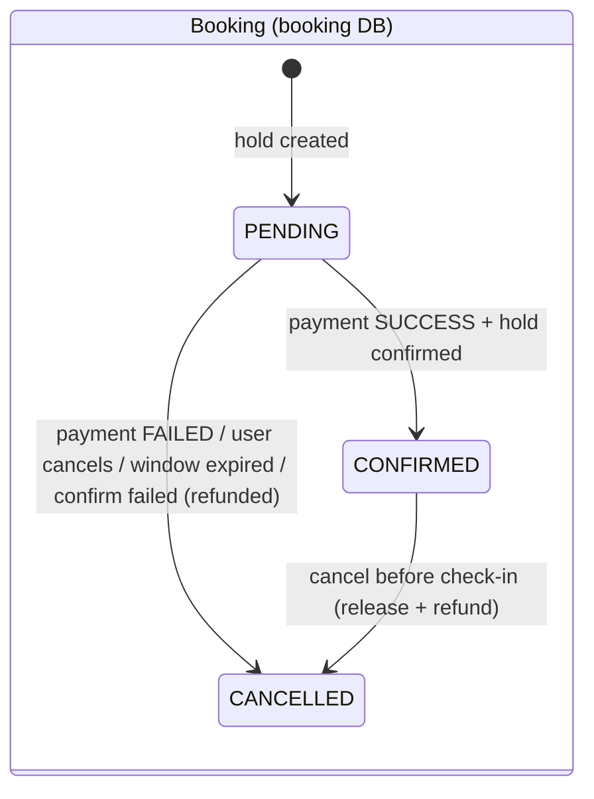
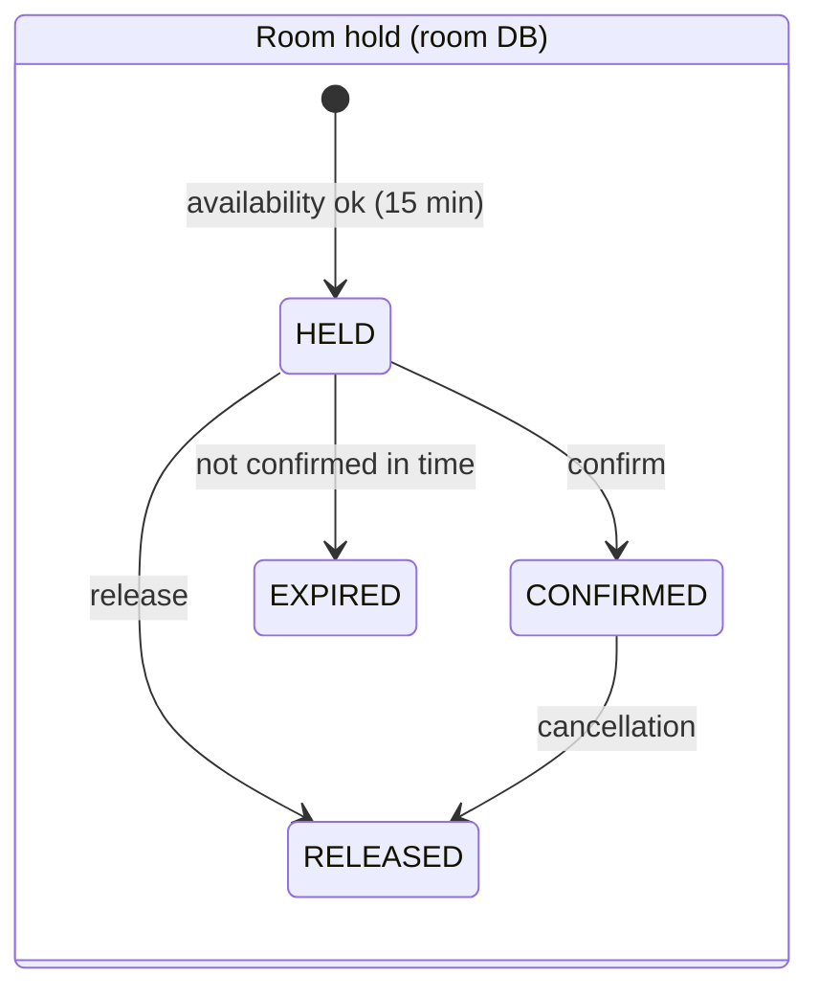

# 09 – Booking Workflow, Collision Prevention and Consistency

## 1. States





| Payment status | Meaning |
|---|---|
| SUCCESS | simulated gateway approved |
| FAILED | declined (demo switch or amount above limit) |
| REFUNDED | successful payment reversed (cancellation or compensation) |

## 2. Step 1 – create booking (`POST /api/bookings`)

1. Gateway checks JWT and `ROLE_USER`.
2. Booking Service validates the body (`@NotNull`, `@FutureOrPresent`, guests 1–10) and the range
   (check-out after check-in, ≤ 30 nights) – invalid requests never reach Room Service.
3. Booking Service → `POST http://ROOM-SERVICE/internal/holds` (user JWT + internal key).
4. Room Service, **in one database transaction**:
   1. `SELECT * FROM rooms WHERE id = ? FOR UPDATE` – lock the room row;
   2. room must be ACTIVE in an active hotel; guests ≤ capacity;
   3. overlap count on `room_holds` must be 0;
   4. calculate price (rules + occupancy);
   5. `INSERT room_holds (status HELD, expires_at = now + 15 min)`;
   6. commit → lock released.
5. Booking Service stores a PENDING booking using the hold's ids, snapshot and **server-calculated amount**.
6. If saving the booking fails, the hold is released immediately (compensation).

## 3. Collision prevention in detail

### 3.1 Overlap rule

Two stays overlap when **each starts before the other ends**:

```
requested.checkIn < existing.checkOut   AND   requested.checkOut > existing.checkIn
```

Check-out is exclusive (the guest leaves in the morning), so back-to-back stays are allowed.

| Existing (room 203) | Requested | Overlap? | Why |
|---|---|---|---|
| 20 → 23 Sep | 22 → 25 Sep | **Yes – rejected** | 22 < 23 and 25 > 20 (specification example) |
| 20 → 23 Sep | 18 → 21 Sep | Yes | 18 < 23 and 21 > 20 |
| 20 → 23 Sep | 21 → 22 Sep | Yes | inside |
| 20 → 23 Sep | 23 → 25 Sep | **No – allowed** | 23 < 23 is false |
| 20 → 23 Sep | 17 → 20 Sep | No | 20 > 20 is false |

Implemented identically in `StayPeriod#overlaps` (unit-tested with all rows above) and in the JPQL of
`RoomHoldRepository#countBlockingHolds` (tested against a real H2 database).

### 3.2 Why a lock is needed

Without a lock, two requests could both run the overlap `SELECT`, both see 0 rows, and both `INSERT` – a classic
*check-then-act* race. PostgreSQL's default READ COMMITTED isolation does not prevent this by itself.

### 3.3 Chosen strategy: pessimistic row lock per room

```
T1: SELECT … FROM rooms WHERE id=3 FOR UPDATE   → lock acquired
T2: SELECT … FROM rooms WHERE id=3 FOR UPDATE   → waits
T1: count overlaps = 0 → INSERT hold → COMMIT   → lock released
T2: lock acquired → count overlaps = 1 → 409 Conflict → ROLLBACK
```

* Serialises only requests for the **same room**; other rooms proceed in parallel.
* Works across **multiple Room Service instances**, because the lock lives in the shared database.
* Simple to explain and to verify.

**Proof:** `ConcurrentHoldIntegrationTest` releases 8 threads at the same instant, all requesting the same room and
dates. Result: exactly **1 success, 7 rejections, 1 row**. As a control experiment the `@Lock` annotation was
temporarily removed: the same test then produced **8 successful holds** (double-booking), confirming that the lock –
not luck – prevents collisions.

**Alternatives considered:** optimistic locking on a room version (causes retries under contention), SERIALIZABLE
isolation (whole-transaction retries), a PostgreSQL `EXCLUDE USING gist` constraint on `daterange` (strongest, but
cannot express the time-based expiry of HELD rows and needs the `btree_gist` extension). The row lock gives
correct behaviour with the least complexity for this project.

## 4. Step 2 – pay (`POST /api/bookings/{id}/pay`)

Booking Service, inside a transaction holding `SELECT … FOR UPDATE` on the booking row:

| # | Action | On failure |
|---|---|---|
| 1 | Booking exists, belongs to caller, status PENDING | 404 / 403 / 409 |
| 2 | Payment window not expired | booking CANCELLED, hold released, no charge |
| 3 | `POST PAYMENT-SERVICE/internal/payments` (amount from booking) | Payment Service unreachable → **503**, booking stays PENDING (user may retry until deadline) |
| 4a | Payment **FAILED** | release hold → booking CANCELLED "Payment failed: …" |
| 4b | Payment **SUCCESS** → `POST ROOM-SERVICE/internal/holds/{id}/confirm` | confirm fails (hold expired, Room Service down) → **refund** payment → booking CANCELLED "Room could not be confirmed – payment refunded" |
| 5 | Booking CONFIRMED with payment id + transaction reference | – |

The row lock means a double-clicked "Pay" is processed sequentially: the second request finds the booking already
CONFIRMED and gets 409. Payment Service additionally refuses a second SUCCESS for the same booking.

## 5. Cancellation and expiry

* **PENDING** → release hold → CANCELLED.
* **CONFIRMED** (only before check-in date) → release hold → refund payment → CANCELLED. Both remote operations are
  idempotent, so a retry after a partial failure is safe.
* **Expiry:** a HELD row stops blocking the room the moment `expires_at` passes (the condition is part of every
  availability query), so inventory is never blocked incorrectly even if Booking Service crashes. Housekeeping
  jobs run every minute: Room Service marks such holds EXPIRED; Booking Service marks the matching PENDING bookings
  CANCELLED.

## 6. Distributed consistency – what is and is not guaranteed

There is **no ACID transaction spanning the three databases**. The workflow is an **orchestration-based saga**:
each step commits locally and each failure path has an explicit compensating action.

| Guarantee | Provided by |
|---|---|
| No two active holds overlap for a room | local transaction + row lock in Room Service |
| Unpaid bookings never block inventory permanently | hold expiry built into availability query |
| Failed payment frees the room | release compensation (and expiry as fallback) |
| Paid but unconfirmable booking is refunded | refund compensation |
| No double payment | booking row lock + Payment Service check |

**Known windows (documented, not hidden):**

1. If Booking Service crashes after Payment SUCCESS but before saving CONFIRMED, the payment exists while the
   booking stays PENDING and later expires. A production system would reconcile using the transactional outbox
   pattern or a periodic reconciliation job comparing `payments` and `bookings`.
2. If both confirm **and** refund fail, the booking is cancelled with reason "refund pending manual review" and an
   ERROR is logged.
3. Holding the booking row lock during synchronous remote calls is acceptable here (short, simulated payment) but
   would be replaced by an intermediate status and asynchronous processing with real payment providers.

## 7. Tests covering the workflow

| Test class | Scenarios |
|---|---|
| `StayPeriodTest` | overlap table above, reversed/past/too-long ranges |
| `RoomHoldRepositoryTest` | confirmed/held block, expired/released do not, date search excludes reserved rooms |
| `ConcurrentHoldIntegrationTest` | 8 concurrent requests → 1 success |
| `InventoryServiceImplTest` | capacity, maintenance room, price stored, expired confirm, idempotent release, ownership |
| `BookingServiceImplTest` | invalid dates, 409 propagation, pending creation, release on save failure, success, payment failure, refund compensation, payment outage, expired window, double payment, ownership, cancel with refund |
| `PaymentServiceImplTest` | success, simulated failure, limit, duplicate success, refund idempotency |
| `RoomServiceClientTest` | JWT + internal key propagation, 409 pass-through, 5xx → 503 |
